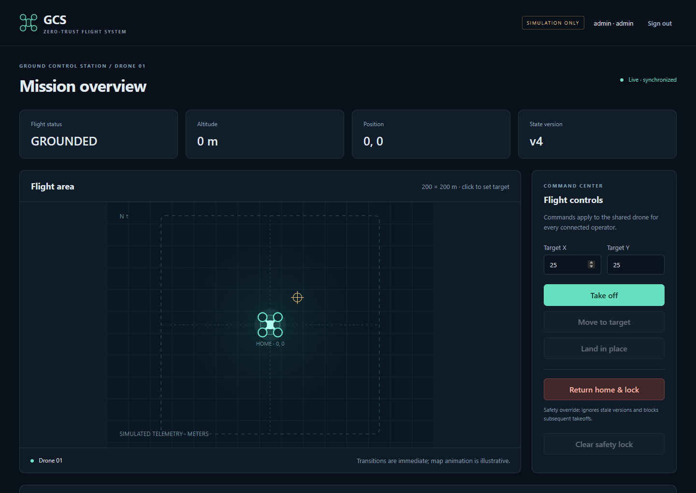
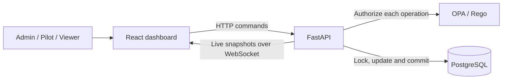

# GCS Drone Control

### One drone. Multiple operators. A shared, consistent state.

A ground control station for learning how authentication, policy decisions, and
concurrency work together. Two pilots can sign in at the same time, but their
commands must still produce one safe outcome. Every dashboard sees the same drone.

Built with **React, FastAPI, PostgreSQL, and OPA**, with Docker for local development
and Kubernetes manifests for AKS. GitHub Actions handles testing and versioned
images; Argo CD handles deployment.

[Local setup](#run-it-locally) · [Architecture](#how-it-works) · [AKS deployment](docs/aks-deployment.md) · [CI/CD](docs/ci-cd.md) · [Build status](https://github.com/akrayi/gcs-drone-control/actions/workflows/release.yml)



> This project controls a simulator. It does not connect to a physical drone.

## What you can do

- Fly a drone on an interactive 2D map: take off, move, land, and return home.
- Sign in from separate browser sessions and watch the dashboards stay synchronized.
- Create pilot and viewer accounts from the admin dashboard.
- Change roles, disable accounts, reset passwords, and revoke existing sessions.
- Test conflicting commands against a real PostgreSQL database.
- Build a new Docker version from main and deploy it through GitOps.

## Run it locally

You need **Docker Desktop with Linux containers** and **Docker Compose v2**.
Run these commands from the project folder in PowerShell:

```powershell
# First setup only. Skip this if you already have a local .env.
./scripts/setup.ps1

docker compose up --build -d
```

On macOS or Linux, generate credentials with `python3 scripts/setup.py` instead.

Open **http://localhost:8080** and sign in with:

| Field | Value |
| --- | --- |
| Username | `admin` |
| Password | The `BOOTSTRAP_ADMIN_PASSWORD` value in your local `.env` |

The setup script generates a random password; there is no default password in the
repository. The bootstrap container creates the initial admin account. Use
**Operators & access** to create your pilots and viewers.

**Try this first:** create two pilots and a viewer, open each account in a separate
browser profile, then move the drone from one pilot's dashboard. The other two
should display the same position and state version.

```powershell
docker compose ps               # Check the services
docker compose logs -f backend  # Follow API logs
docker compose down             # Stop the stack; keep the database volume
```

See [local development and testing](docs/local-development.md) for troubleshooting,
frontend development, and test commands.

## How it works



| Component | Its responsibility | Source |
| --- | --- | --- |
| React frontend | Flight map, controls, account management, live telemetry | [frontend/](frontend/) |
| FastAPI backend | Authentication, request validation, transactions, live snapshots | [backend/app/](backend/app/) |
| OPA service | Decide which role may perform an operation | [policy/](policy/) |
| PostgreSQL | Store users, one authoritative drone state, and command receipts | [database/](database/) |
| Kubernetes | Run services, isolate traffic, and retain database storage | [k8s/](k8s/) |

These are separate services. The browser never decides whether a command is
allowed, and an API replica never owns its own independent drone state.

### Who can do what?

| Capability | Viewer | Pilot | Admin |
| --- | :---: | :---: | :---: |
| Read telemetry and command history | Yes | Yes | Yes |
| Take off, move, land, return home | — | Yes | Yes |
| Clear the safety lock | — | — | Yes |
| Create users and manage access | — | — | Yes |

OPA checks these permissions on the server. Changing a user's role or password,
or disabling their account, revokes their previous sessions.

### What happens when commands conflict?

Every ordinary command includes the drone version the operator saw. PostgreSQL
locks the shared drone row while the backend checks that version and applies the
command. A command based on an old version receives a conflict response.

**RETURN_HOME has priority through a persistent safety lock.** It lands an airborne
drone at home and blocks further takeoffs until an admin clears the lock.

| Requests reach the database in this order | Result |
| --- | --- |
| TAKEOFF, then RETURN_HOME | Takeoff applies, then the drone returns, lands, and locks |
| RETURN_HOME, then TAKEOFF | Return locks the drone; takeoff is rejected |

A grounded drone stays where it is when RETURN_HOME arrives. It never takes off
just to return home. The guarantee concerns the final state after both requests
finish; a takeoff that commits first can briefly be visible before the return.

The state update and its command receipt commit together. Retrying the same request
ID returns the original receipt without executing the command twice.

Read the [architecture and safety guide](docs/architecture.md) for transaction
boundaries, token handling, WebSocket behavior, and the full file map.

## From a code change to AKS

```mermaid
flowchart LR
    PR[Feature pull request] --> CI[Tests and checks]
    CI --> MAIN[Merge to main]
    MAIN --> BUILD[Build version vN]
    BUILD --> ACR[Azure Container Registry]
    ACR --> SCAN[Image vulnerability gate]
    SCAN --> GIT[Update deploy branch]
    GIT --> ARGO[Argo CD sync]
    ARGO --> AKS[AKS rolling update]
```



Image versions are assigned automatically: **v1, v2, v3, ...** Both application
images use the same version, and Kubernetes references also include immutable
image digests. Failed or skipped release runs can leave gaps in the numbering.

- **main** contains the source you edit.
- **deploy** contains the tested manifests and image versions maintained by CI.
- **Argo CD** watches deploy and reconciles the cluster with it.

The workflows are included and CI is enabled. Azure publishing waits until the
Azure identity and registry variables are configured. No Azure resources are
created merely by cloning this repository or running the tests.

| Next step | Guide |
| --- | --- |
| Connect GitHub Actions to Azure using OIDC | [CI/CD setup](docs/ci-cd.md#one-time-connection) |
| Deploy PostgreSQL, API, OPA, and frontend to AKS | [AKS deployment](docs/aks-deployment.md) |
| Configure managed application routing and TLS | [Gateway API example](docs/aks-deployment.md#aks-managed-application-routing-option) |

## Checks included

```powershell
# Real PostgreSQL and OPA integration tests in isolated containers
docker compose --profile test run --build --rm tests

# Rego role-policy tests
docker compose --profile test run --rm policy-tests
```

The suite covers concurrent TAKEOFF/RETURN_HOME, duplicate requests, atomic
rollback, safe grounded behavior, role restrictions, account management, token
expiry, and WebSocket revocation. CI also builds the frontend, starts the complete
Docker stack, checks admin login and safety commands, audits dependencies, and
validates Kubernetes manifests.

## Credentials and security

**Never commit `.env`, private keys, or real Kubernetes Secret values.** They are
excluded from Git. Example manifests contain placeholders only.

Locally, `.env` supplies generated setup credentials. On AKS, the bootstrap Job
reads the initial admin password from a Kubernetes Secret. PostgreSQL stores only
its Argon2 hash. The frontend receives neither the Secret nor the signing key.
Changing the bootstrap Secret does not reset an existing account's password.

This is a learning system with explicit security controls, not a production
certification. The base manifests do not encrypt internal service traffic, and
the database runs as one instance. Production use needs service-to-service TLS,
backup and recovery procedures, external identity/MFA, operational rate limits,
and reviewed database migrations. See the [documented security boundaries](docs/architecture.md#security-boundaries-and-next-steps).
